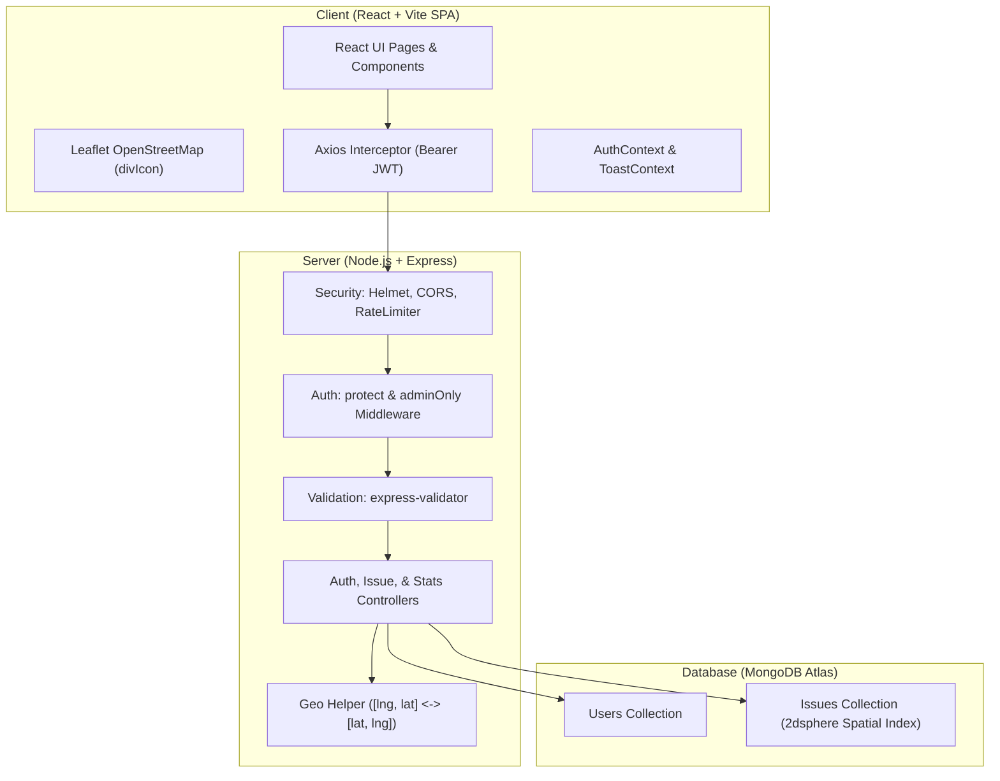

# CivicPulse — Community Issue Reporter

CivicPulse is a full-stack MERN (MongoDB, Express, React, Node.js) web application that empowers citizens to report hyper-local civic infrastructure issues (potholes, non-functional streetlights, illegal garbage dumps, burst water mains, and damaged roads) by dropping precise pins on an interactive OpenStreetMap. Municipal administrators review incoming citizen reports through an analytics dashboard, verify issues, and transition them through an auditable status workflow with mandatory explanatory comments.

---

## Table of Contents
- [Project Overview](#project-overview)
- [Screenshots & UI Walkthrough](#screenshots--ui-walkthrough)
- [Feature Highlights](#feature-highlights)
- [Technology Stack](#technology-stack)
- [Architecture & Data Flow](#architecture--data-flow)
- [Folder Structure](#folder-structure)
- [API Route Reference](#api-route-reference)
- [Environment Variables](#environment-variables)
- [Local Development Setup](#local-development-setup)
- [Database Seeding](#database-seeding)
- [Deployment Guide (Render + Vercel + MongoDB Atlas)](#deployment-guide-render--vercel--mongodb-atlas)
- [Demo Credentials](#demo-credentials)
- [Future Enhancements](#future-enhancements)
- [License](#license)

---

## Project Overview

Local civic maintenance frequently suffers from opaque communication, unrecorded complaint statuses, and lack of visual spatial tracking. **CivicPulse** bridges this gap:
1. **Citizens** drop pins directly onto Leaflet maps using GPS geolocation or manual clicks, track reported issues, upvote pressing neighborhood problems, and receive updates directly from city administrators.
2. **Administrators** gain a single-pane-of-glass dashboard equipped with Recharts status and category distributions, real-time stat cards, filtering tools, and a status transition engine that logs an auditable history trail.
3. **Transparency First:** Every citizen can inspect what issues are active, in progress, or verified as resolved.

---

## Screenshots & UI Walkthrough

| Interactive Map Page | Issue Details & Status Timeline |
| :---: | :---: |
|  <br/>*Full-screen Leaflet map with custom status-colored pins (Red = Open, Amber = In Progress, Green = Resolved)* |  <br/>*Individual issue page featuring a mini-map, upvote counter, and chronological admin trail* |

| Admin Analytics Dashboard | Mobile Responsive View |
| :---: | :---: |
|  <br/>*Stat cards, category bar charts, status donut charts, and issue table* |  <br/>*Mobile-first design with responsive drawers, touch controls, and inline validation* |

---

## Feature Highlights

### Citizen Workflows
- **Seamless Authentication:** Secure JWT registration and login with passwords hashed using `bcryptjs`. Session persists across browser reloads with auto-logout on token expiration.
- **Interactive OpenStreetMap Explorer:** Full-screen Leaflet map rendered using OpenStreetMap tiles (zero proprietary Google Maps API keys required). Pins color-coded by issue status using custom SVG `divIcon` markers:
  - 🔴 **Red:** Open issue
  - 🟡 **Amber:** In Progress / Crew dispatched
  - 🟢 **Green:** Resolved & verified fixed
- **Intuitive Pin-Drop Reporting:**
  - One-click pin placement anywhere on the interactive map.
  - "Use My Current Location" button utilizing browser GPS geolocation with graceful handling for denied permissions, timeouts, and secure HTTPS requirements.
  - Form validation with inline character counters: Title (5–100 chars), Description (10–1000 chars), Category selection, and optional image URL.
- **Searchable & Filterable Issue Directory:**
  - Full-text search by title or description.
  - Status filter tabs (All, Open, In Progress, Resolved).
  - Category selector (Pothole, Streetlight, Garbage, Water Leak, Road Damage, Other).
  - Multi-tier sorting (Newest first, Most upvoted first).
  - Clean pagination (10 issues per page).
- **Issue Detail & Upvoting:**
  - Dedicated issue page with high-resolution image banner, description, and single-pin mini Leaflet map.
  - Toggleable upvotes (1 upvote per citizen) to elevate critical community hazards.
  - Chronological Status History timeline displaying every administrative transition, timestamp, and official municipal note.
- **"My Reports" Dashboard:** Personalized view of all issues reported by the authenticated citizen, displaying real-time status and the latest administrative response.

### Administrator Workflows
- **Role-Enforced Security:** Administrative routes are protected on both the frontend (`AdminRoute`) and backend server (`adminOnly` middleware returning 403 Forbidden). Public registration is strictly locked to `citizen`.
- **Admin Command Center:**
  - Real-time stat metric cards: Total Reports, Open, In Progress, Resolved, and Total Community Upvotes.
  - Recharts category frequency bar chart.
  - Recharts status distribution donut chart.
  - Comprehensive issue management table with search and filtering.
- **Audited Status Transitions:**
  - Transition any issue between `open`, `in_progress`, and `resolved`.
  - Mandatory administrative comment required for every transition.
  - Each update appends a permanent log entry to `statusHistory` recording the admin's name, user ID, comment, and timestamp.
- **Spam & Invalidation Deletion:** Administrators can permanently remove fraudulent or duplicate issue submissions.

---

## Technology Stack

| Layer | Technologies |
| :--- | :--- |
| **Frontend** | React 19 (Vite), React Router 7, Axios, Leaflet & React-Leaflet, Tailwind CSS 3, Recharts, Lucide React |
| **Backend** | Node.js, Express 4, Mongoose 8 |
| **Database** | MongoDB Atlas (Cloud) / Local MongoDB with `2dsphere` spatial indexing |
| **Authentication** | JWT (JSON Web Tokens), `bcryptjs` password hashing |
| **Validation** | `express-validator` on backend; inline field validations on client |
| **Security** | `helmet`, `cors` (origin restricted to `CLIENT_URL`), `express-rate-limit` on auth endpoints |
| **Deployment** | Vercel (Client SPA with `vercel.json`), Render (Express API), MongoDB Atlas (Cloud Database) |

---

## Architecture & Data Flow



### Coordinate Handling Rule
- **GeoJSON Standard:** MongoDB requires Point coordinates in `[longitude, latitude]` format with a `2dsphere` index for spatial queries.
- **Leaflet Standard:** Leaflet requires coordinates in `[latitude, longitude]` format.
- **Dedicated Conversion:** Handled bidirectionally via `server/src/utils/geo.js` and `client/src/utils/geo.js` to prevent coordinate inversion errors.

---

## Folder Structure

```
civicpulse/
├── server/
│   ├── src/
│   │   ├── config/
│   │   │   └── db.js                 # MongoDB connection & local engine fallback
│   │   ├── controllers/
│   │   │   ├── authController.js     # Register, login, getMe
│   │   │   ├── issueController.js    # Issue CRUD, upvotes, status update, filters
│   │   │   └── statsController.js    # Aggregations for admin dashboard
│   │   ├── middleware/
│   │   │   ├── auth.js               # protect (Bearer JWT verification)
│   │   │   ├── roles.js              # adminOnly (403 role enforcement)
│   │   │   ├── errorHandler.js       # Centralized JSON error handler
│   │   │   └── validate.js           # express-validator result formatter
│   │   ├── models/
│   │   │   ├── User.js               # Name, unique lowercase email, hidden passwordHash, role
│   │   │   └── Issue.js              # GeoJSON Point, status, upvotes, statusHistory
│   │   ├── routes/
│   │   │   ├── authRoutes.js         # /api/auth endpoints with rate limiter
│   │   │   ├── issueRoutes.js        # /api/issues endpoints
│   │   │   └── statsRoutes.js        # /api/stats endpoint
│   │   ├── seed/
│   │   │   └── seed.js               # Seeder for 1 admin, 3 citizens, 20 Bengaluru issues
│   │   ├── utils/
│   │   │   ├── generateToken.js      # JWT signing utility
│   │   │   └── geo.js                # Server coordinate conversion helper
│   │   ├── app.js                    # Express app configuration & middleware
│   │   └── server.js                 # Server entry point & graceful shutdown
│   ├── .env.example                  # Server environment variable templates
│   ├── .gitignore
│   └── package.json
│
├── client/
│   ├── src/
│   │   ├── api/
│   │   │   └── axios.js              # Axios instance with Bearer token & 401 interceptor
│   │   ├── components/
│   │   │   ├── Navbar.jsx            # Role-aware navigation bar
│   │   │   ├── IssueMap.jsx          # Leaflet map with custom divIcon pins & popups
│   │   │   ├── IssueCard.jsx         # Card component with image, badges, & upvote button
│   │   │   ├── StatusBadge.jsx       # Visual status pill with pulse indicator
│   │   │   ├── CategoryBadge.jsx     # Formatted category badge
│   │   │   ├── StatusTimeline.jsx    # Chronological status audit trail
│   │   │   ├── ProtectedRoute.jsx    # Authentication route guard
│   │   │   ├── AdminRoute.jsx        # Administrator route guard
│   │   │   ├── Spinner.jsx           # Accessible loading spinner
│   │   │   └── Skeleton.jsx          # Loading skeleton cards
│   │   ├── context/
│   │   │   ├── AuthContext.jsx       # Auth provider (login, register, logout, session)
│   │   │   └── ToastContext.jsx      # Global floating toast alert system
│   │   ├── pages/
│   │   │   ├── Home.jsx              # Full-screen interactive map with filter pills
│   │   │   ├── IssueList.jsx         # Issue directory with search, filter, sort, pagination
│   │   │   ├── IssueDetail.jsx       # Detail view with mini-map, upvote, timeline
│   │   │   ├── ReportIssue.jsx       # Pin drop & GPS reporting flow with validation
│   │   │   ├── MyReports.jsx         # Citizen's personal issues & latest admin notes
│   │   │   ├── AdminDashboard.jsx    # Metrics cards, Recharts charts, management table
│   │   │   ├── Login.jsx             # Login page with demo credentials quick-fill
│   │   │   ├── Register.jsx          # Citizen registration with validation
│   │   │   └── NotFound.jsx          # Custom 404 page
│   │   ├── utils/
│   │   │   ├── constants.js          # Categories, statuses, color codes
│   │   │   ├── geo.js                # Client coordinate conversion & formatting
│   │   │   └── markers.js            # Custom Leaflet divIcon SVG generators
│   │   ├── App.jsx                   # Route configuration
│   │   ├── index.css                 # Tailwind directives & Leaflet styling
│   │   └── main.jsx                  # Application entry point
│   ├── .env.example                  # Client environment variable templates
│   ├── index.html                    # HTML shell with Inter typography & favicon
│   ├── postcss.config.js
│   ├── tailwind.config.js
│   ├── vercel.json                   # SPA routing rewrite rule for Vercel
│   └── package.json
│
├── .gitignore
└── README.md
```

---

## API Route Reference

All API routes are served under `/api` and respond with consistent JSON structures. Errors adhere to `{ message: string, errors?: array }`.

### Authentication Endpoints (`/api/auth`)
| Method | Endpoint | Access | Rate Limited | Description |
| :--- | :--- | :--- | :---: | :--- |
| `POST` | `/api/auth/register` | Public | Yes (30 / 15m) | Registers a new user. Role is strictly enforced to `citizen`. |
| `POST` | `/api/auth/login` | Public | Yes (30 / 15m) | Authenticates credentials and returns a signed JWT. |
| `GET` | `/api/auth/me` | Protected | No | Returns the authenticated user's profile. |

### Issue Endpoints (`/api/issues`)
| Method | Endpoint | Access | Query / Body Parameters | Description |
| :--- | :--- | :--- | :--- | :--- |
| `GET` | `/api/issues` | Public | `status`, `category`, `search`, `sort` (`newest` \| `upvotes`), `page`, `limit` | Returns paginated issues `{ issues, total, page, pages }`. |
| `GET` | `/api/issues/mine` | Protected | None | Returns issues reported by the logged-in citizen. |
| `GET` | `/api/issues/:id` | Public | None | Returns complete issue details with populated creator and timeline. |
| `POST` | `/api/issues` | Protected | `{ title, description, category, latitude, longitude, imageUrl? }` | Reports a new issue and creates the initial open timeline entry. |
| `POST` | `/api/issues/:id/upvote`| Protected | None | Toggles citizen's upvote (1 per user). |
| `PATCH` | `/api/issues/:id/status`| Admin Only | `{ status, comment }` | Transitions status (`open`, `in_progress`, `resolved`) with mandatory note. |
| `DELETE` | `/api/issues/:id` | Admin Only | None | Permanently removes an issue. |

### Analytics Endpoints (`/api/stats`)
| Method | Endpoint | Access | Description |
| :--- | :--- | :--- | :--- |
| `GET` | `/api/stats` | Admin Only | Returns total count, status breakdown, category distribution, total upvotes, and recent issues. |

### Health Check
| Method | Endpoint | Access | Description |
| :--- | :--- | :--- | :--- |
| `GET` | `/api/health` | Public | Returns service uptime and server status for cloud health probes. |

---

## Environment Variables

> [!IMPORTANT]
> Real credentials, connection strings, or JWT secrets must never be committed to version control. Set these in your hosting dashboards (Render, Vercel) or local `.env` files.

### Server (`server/.env`)
| Variable Name | Required | Default / Example Value | Description |
| :--- | :---: | :--- | :--- |
| `PORT` | No | `5000` | Port for Express HTTP server |
| `NODE_ENV` | No | `development` | Environment mode (`development` \| `production`) |
| `MONGO_URI` | Yes | `mongodb+srv://<user>:<password>@cluster.mongodb.net/civicpulse` | MongoDB Atlas connection string |
| `JWT_SECRET` | Yes | `your_secure_random_key_min_32_chars` | Secret key used to sign and verify JWT tokens |
| `JWT_EXPIRES_IN`| No | `7d` | Token validity duration |
| `CLIENT_URL` | Yes | `http://localhost:5173` | Allowed frontend origin for strict CORS enforcement |
| `ADMIN_EMAIL` | No | `admin@civicpulse.org` | Email for default admin account created during database seed |
| `ADMIN_PASSWORD`| No | `AdminSecurePass123!` | Password for default admin account created during database seed |

### Client (`client/.env`)
| Variable Name | Required | Default / Example Value | Description |
| :--- | :---: | :--- | :--- |
| `VITE_API_URL` | Yes | `http://https://civicpulse-0w1p.onrender.com/api` | Base URL of the backend API |

---

## Local Development Setup

### Prerequisites
- **Node.js**: v18.0.0 or higher (v20+ recommended)
- **npm**: v9.0.0 or higher
- **MongoDB**: MongoDB Atlas URI or local MongoDB instance

### 1. Clone & Install Dependencies
```bash
# Clone the repository
git clone https://github.com/your-username/civicpulse.git
cd civicpulse

# Install server dependencies
cd server
npm install

# Install client dependencies
cd ../client
npm install
```

### 2. Configure Environment Variables
```bash
# In server directory:
cp .env.example .env

# In client directory:
cp .env.example .env
```
Update `server/.env` with your `MONGO_URI` and a secure `JWT_SECRET`.

### 3. Seed the Database
Populate the database with the initial Administrator account, 3 citizen profiles, and 20 realistic Bengaluru civic issues:
```bash
cd server
npm run seed
```

### 4. Run Locally
Open two terminal windows:

**Terminal 1 — Backend Server:**
```bash
cd server
npm run dev
# Server will run at http://https://civicpulse-0w1p.onrender.com
# Health check available at http://https://civicpulse-0w1p.onrender.com/api/health
```

**Terminal 2 — Frontend Client:**
```bash
cd client
npm run dev
# Vite dev server will start at http://localhost:5173
```

Visit `http://localhost:5173` in your browser.

---

## Database Seeding

The database seeder (`server/src/seed/seed.js`) automatically:
- Clears existing collections.
- Creates **1 Admin Account** (using `ADMIN_EMAIL` and `ADMIN_PASSWORD` from `.env`).
- Creates **3 Citizen Accounts** with hashed passwords.
- Creates **20 Realistic Civic Reports** distributed across metropolitan Bengaluru (Indiranagar, Koramangala, MG Road, Whitefield, HSR Layout, Malleshwaram, etc.) with accurate GeoJSON coordinates, diverse categories (`pothole`, `streetlight`, `garbage`, `water_leak`, `road_damage`, `other`), status distributions (`open`, `in_progress`, `resolved`), community upvotes, and multi-step `statusHistory` timeline entries.

Run the seeder anytime with:
```bash
cd server
npm run seed
```

---

## Deployment Guide (Render + Vercel + MongoDB Atlas)

### Step 1: MongoDB Atlas
1. Create a free M0 cluster at [MongoDB Atlas](https://www.mongodb.com/atlas).
2. Under **Network Access**, add `0.0.0.0/0` (allow access from anywhere) so Render can connect.
3. Under **Database Access**, create a database user with Read/Write privileges.
4. Copy your connection string: `mongodb+srv://<username>:<password>@cluster0.mongodb.net/civicpulse?retryWrites=true&w=majority`.

### Step 2: Backend on Render
1. Create a new **Web Service** on [Render](https://render.com) connected to your GitHub repository.
2. Configure settings:
   - **Root Directory:** `server`
   - **Environment:** `Node`
   - **Build Command:** `npm install`
   - **Start Command:** `npm start`
3. Add Environment Variables in Render:
   - `NODE_ENV`: `production`
   - `PORT`: `10000` (or Render default)
   - `MONGO_URI`: *Your MongoDB Atlas connection string*
   - `JWT_SECRET`: *A secure random string (minimum 32 characters)*
   - `JWT_EXPIRES_IN`: `7d`
   - `CLIENT_URL`: `https://your-civicpulse.vercel.app` *(Your Vercel app URL)*
   - `ADMIN_EMAIL`: `admin@civicpulse.org`
   - `ADMIN_PASSWORD`: *Your chosen admin password*
4. Click **Deploy**. Note your service URL (e.g., `https://civicpulse-api.onrender.com`).
5. Run the seed script remotely via the Render Shell tab: `npm run seed`.

### Step 3: Frontend on Vercel
1. Import the repository on [Vercel](https://vercel.com).
2. Configure project settings:
   - **Framework Preset:** `Vite`
   - **Root Directory:** `client`
   - **Build Command:** `npm run build`
   - **Output Directory:** `dist`
3. Add Environment Variables in Vercel:
   - `VITE_API_URL`: `https://civicpulse-api.onrender.com/api` *(Your Render backend URL with /api suffix)*
4. Click **Deploy**.
5. Once deployed, verify that page refreshes on deep routes like `/issues` or `/admin` work seamlessly via the bundled `client/vercel.json` SPA rewrite rules.

---

## Demo Credentials

The seed script creates the following pre-configured demonstration accounts for immediate testing:

### Municipal Administrator
- **Email:** `admin@civicpulse.org`
- **Password:** `AdminSecurePass123!` *(or the custom value specified in your `ADMIN_PASSWORD` env variable)*
- **Privileges:** Access to `/admin`, Recharts analytics, status update modal with mandatory comment logging, issue deletion.

### Citizen Accounts
| Name | Email | Password | Role |
| :--- | :--- | :--- | :---: |
| Aarav Sharma | `aarav@example.com` | `password123` | Citizen |
| Priya Venkatesh | `priya@example.com` | `password123` | Citizen |
| Rohan Deshmukh | `rohan@example.com` | `password123` | Citizen |

*(The Login page also includes **"Quick Fill Demo Credentials"** one-click buttons to make evaluator testing effortless.)*

---

## Future Enhancements
- **Push & Email Notifications:** Automatic notifications to citizens when their reported issue transitions from `in_progress` to `resolved`.
- **Photo Upload to Cloud Storage:** Direct camera capture and upload to AWS S3 or Cloudinary.
- **Geofenced Ward Clustering:** Automatic municipal ward assignment based on GeoJSON polygon boundaries.
- **Duplicate Detection:** Spatial clustering to flag duplicate reports filed within 50 meters of an active issue.

---

## License
MIT License. Built for civic empowerment and municipal infrastructure transparency.
